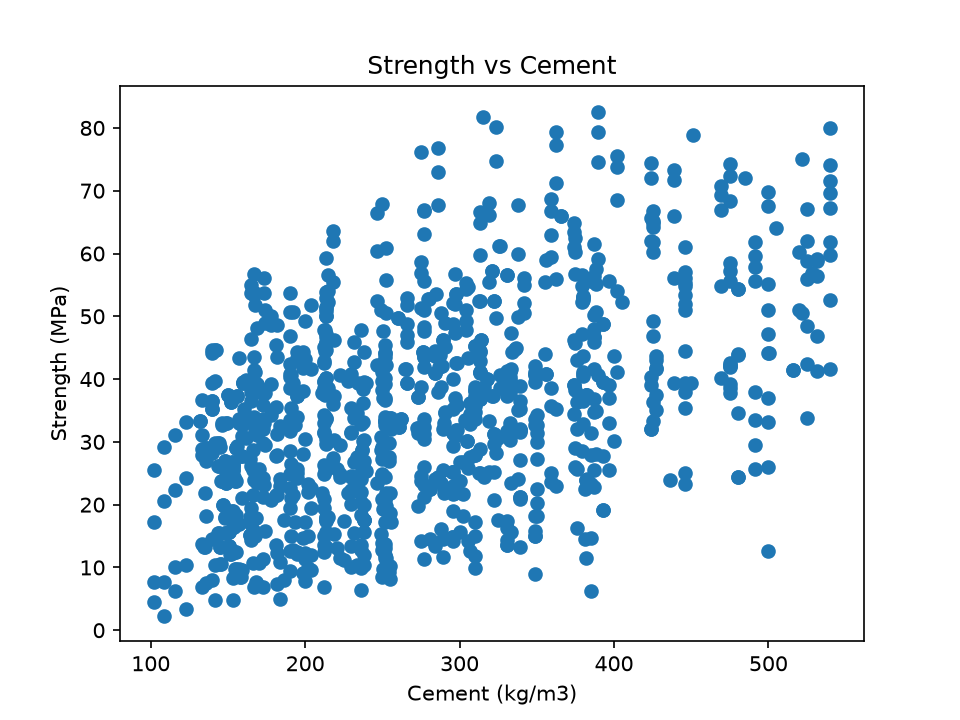
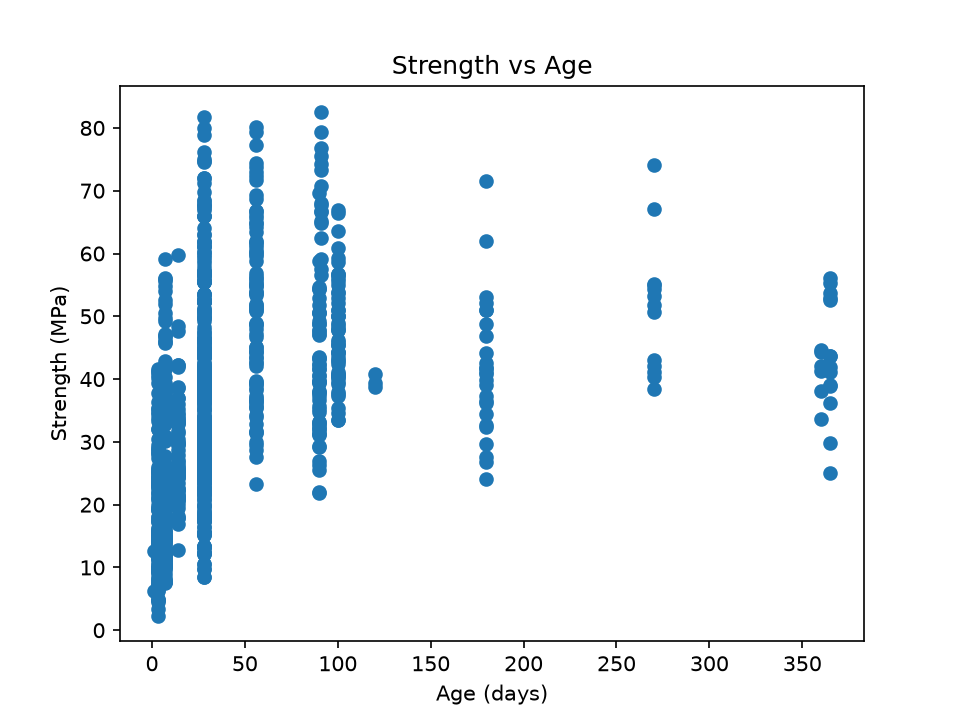
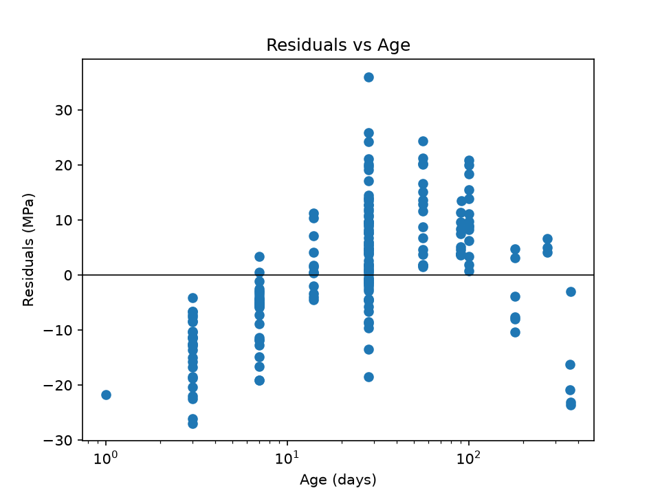
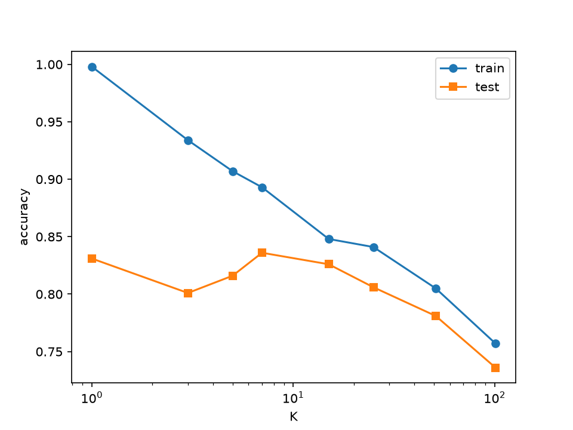
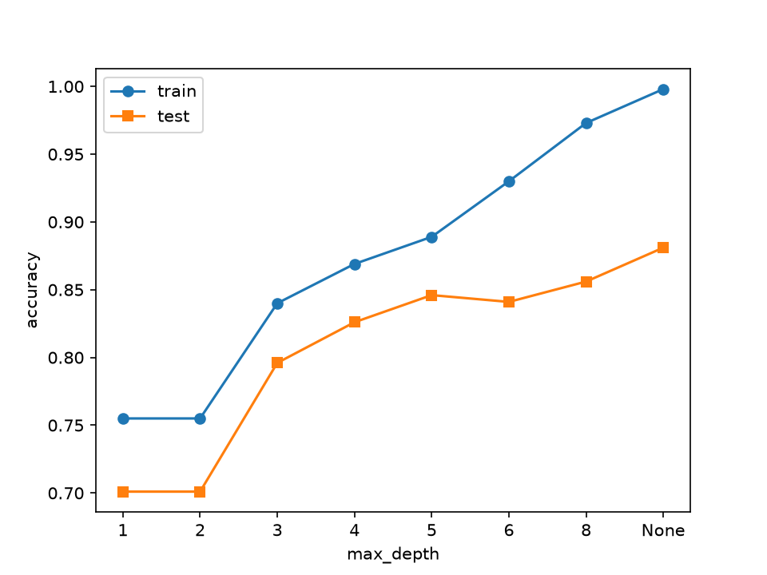
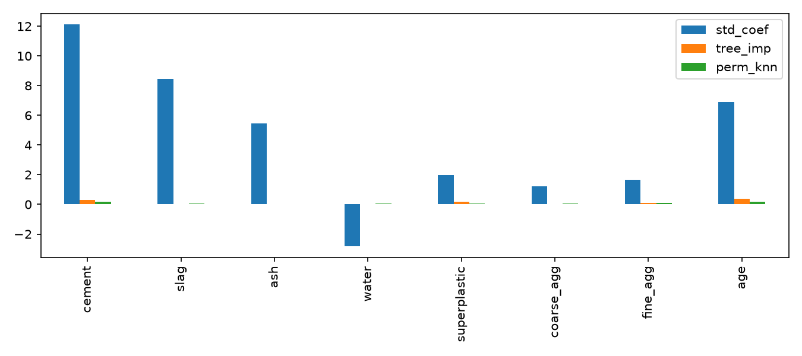
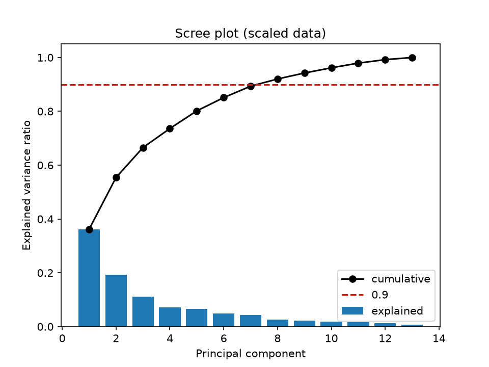
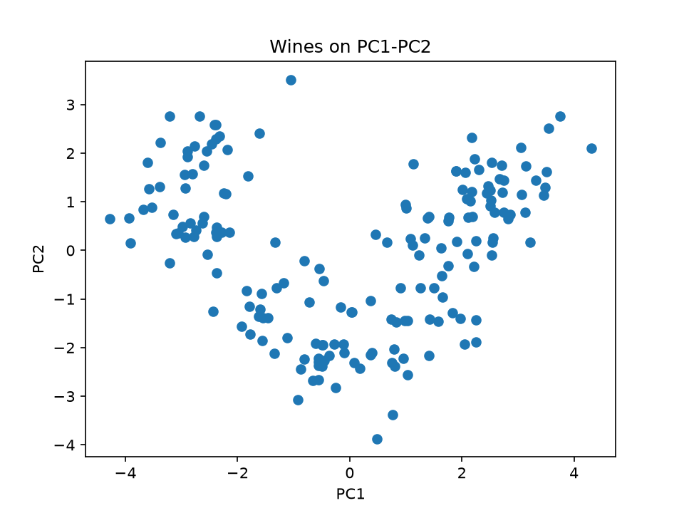
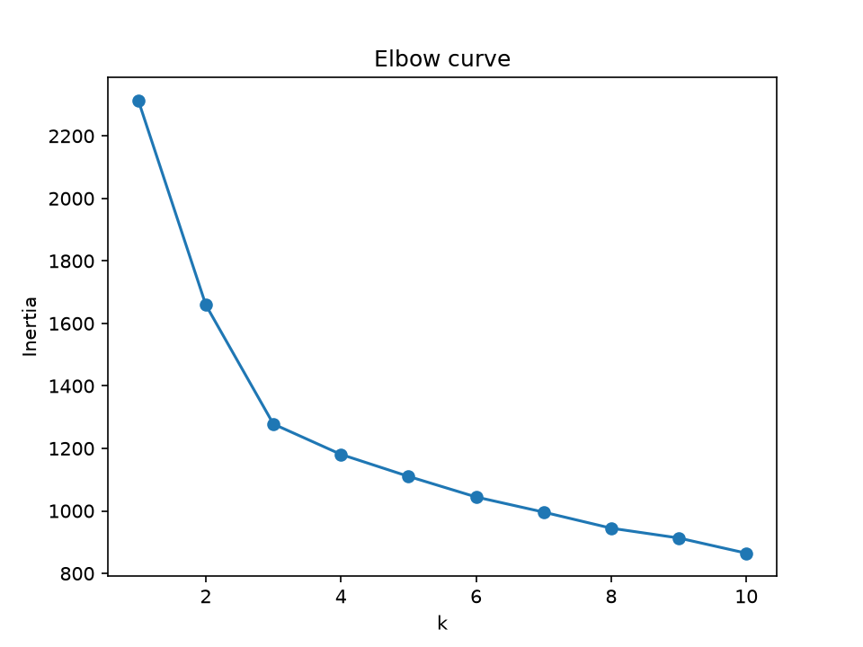
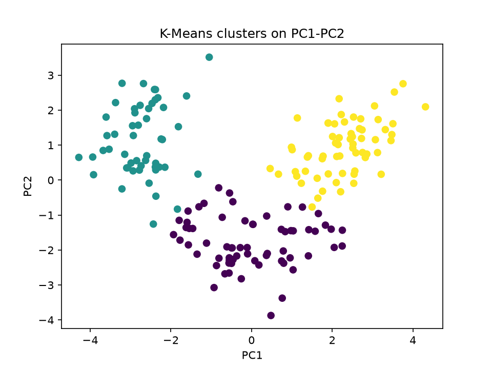

# CSPC - Computer Science for Physics and Chemistry

My coursework repository. Each practical is under PW<n>/Lab <X>/.

## Setup

Create the environment for a given lab:

conda env create -f PW<n>/Lab\ <X>/environment.yml
conda activate cspc

For PW2 to PW4 the environment also needs `scipy`, `pandas`, `matplotlib`, `scikit-learn` and `snakemake`; for PW4 also `ucimlrepo` (`pip install ucimlrepo`).

## PW1 - Lab A: Reproducible Foundations

### What I built

- A conda environment (`environment.yml`) with Python 3.11, numpy and pytest, and a Git repository (CSPC) connected to GitHub.
- A radioactive decay simulation with a pure-Python version (`simulate_loop`) and a NumPy version (`simulate`).
- Three tests in `test_decay_STUDENT.py` and a speed comparison in `speed.py`.

### Tests

| test | what it checks |
|---|---|
| `test_starts_at_N0` | at time zero no atoms have decayed: `simulate(1000, 0.4)[0] == 1000` |
| `test_rejects_negative_rate` | a negative decay rate raises a `ValueError` (`pytest.raises`) |
| `test_matches_law` | the average of 100 simulations (different seeds) is close to `N0 * exp(-lambda * t)` (`pytest.approx`, 10% tolerance) |

All tests pass with `pytest -v`.

### Speed comparison (loop vs NumPy)

Setup: `N0 = 200000` atoms, `lambda = 0.4`, `dt = 0.05`, 200 steps, timed with `time.perf_counter()`.

| version | time |
|---|---|
| pure-Python loop | 1.98184 s |
| NumPy | 0.0001789 s |
| speed-up | about 11650 times faster |

### Conclusion

- The simulation works correctly and all three tests pass.
- NumPy is about 11650 times faster than the pure-Python loop because it does the work on the whole array at once instead of one atom at a time.
- Tests and a fixed environment make the code reproducible on another machine.

## PW1 - Lab B: Data, Plotting, and Automation

### What I built

- `plot_STUDENT.py`: reads `decay_observed.csv` (columns time, count), computes the analytical law and draws a 1x2 figure with shared axes: observed points on the left, the analytical curve on the right.
- A `Snakefile` with one rule that builds `figure.png`.

### Method

- Analytical law: `N(t) = N0 * exp(-lambda * t)` with `lambda = 0.3` and `N0` = the first observed count.
- Shared x and y axes make the two panels directly comparable.

### Result

The observed counts decrease with time in the same way as the analytical curve: both panels have the same decreasing shape on the same scale. The observed data matches the decay law reasonably well; the observed points scatter around the curve because of measurement noise.

### Snakemake

- Rule `plot`: input `decay_observed.csv` and `plot_STUDENT.py`, output `figure.png`, command `python plot_STUDENT.py`.
- First run builds the figure. After deleting `figure.png` the same command rebuilds it. A third run without changes does nothing, because the output is newer than its inputs.
- If the data or the script changes, the figure is older than its input, so Snakemake rebuilds it.

### Conclusion

- The decay data agrees with the analytical law with lambda = 0.3.
- A small Snakemake pipeline keeps the figure consistent with its data and script, and rebuilds only what changed.

## PW2 - Lab A: Motion from Tracking Data

### What I built

- `analysis.py`: reads `freefall.csv` (time, height of an object dropped from about 500 m, sampled every 0.1 s), differentiates and integrates it, and draws `motion.png`.
- Bonus: a 2D tracked trajectory from `trajectory.csv`.

### Method

- Velocity `v = np.gradient(y, t)`, acceleration `a = np.gradient(v, t)`.
- Integration back with `cumulative_trapezoid(a, t, initial=0) + v[0]` for velocity and again with `y[0]` for position.

### Results

| quantity | value |
|---|---|
| mean acceleration | -8.5797 m/s² (expected for free fall: -9.81 m/s²) |
| standard deviation of the acceleration | 28.71 m/s² |
| largest difference between original and recovered position | 0.7846 m |

### Noise observation

The acceleration is much noisier than the position because differentiation amplifies small measurement noise, and the acceleration comes from two derivatives. The individual values swing wildly (std 28.7 m/s²) although the true acceleration is constant.

### What integrating back showed

Integration is a sum, so random noise partly cancels. Although the acceleration was noisy, the recovered position agrees with the original within 0.78 m, so integration suppresses noise while differentiation amplifies it.

### Conclusion

- The measured mean acceleration (-8.58) is roughly of the right size compared with the expected -9.81, so the object is in free fall. The difference is partly caused by the very noisy values at the ends of the record: without the first and last two points the mean is about -9.25.
- Differentiation made the noise much larger; integration recovered the position to within about 1 metre.
- Results are plotted in `motion.png` (three stacked panels with a dashed line at -9.81).

### Bonus - 2D tracked trajectory

- Read `trajectory.csv` (time, x, y) and differentiated x and y separately with `np.gradient` to get `vx` and `vy`.
- Speed = `sqrt(vx² + vy²)`.
- Saved the path as `trajectory.png` and the speed over time as `speed.png`.

## PW2 - Lab B: Optimization in Chemistry

### What I built

- `warmup_STUDENT.py`: three optimisation methods compared on two functions.
- `kinetics_STUDENT.py`: fit of a first-order rate constant.
- `equilibrium_STUDENT.py`: chemical equilibrium of H2 + I2 <-> 2 HI solved two ways.
- `titration_STUDENT.py` (bonus): equivalence point of a titration.

### Part 2 - Three routes to a minimum

| function | start | gradient descent | Newton (f'(x)=0) | SLSQP |
|---|---|---|---|---|
| f(x) = (x-3)^2 + 1 | x0 = 0 | 3.000 | 3.000 | 3.000 |
| g(x) = x^4 - 3x^2 + x + 5 | x0 = 0 | -1.301 | 0.170 (maximum) | -1.301 |
| g(x) = x^4 - 3x^2 + x + 5 | x0 = 2 | -1.301 | 1.131 (minimum) | -1.301 |

- On the easy convex function all three methods agree (x = 3).
- On g(x) the methods disagree. Newton from x0 = 0 landed on x = 0.170 where g'' < 0, so it is a maximum, not a minimum. Newton from x0 = 2 landed on x = 1.131, a local minimum that is not the global one (g = 3.93 compared with g = 1.49 at x = -1.301).
- Gradient descent and SLSQP found the global minimum x = -1.301 from both starting points.
- Newton's method only looks for g'(x) = 0 and does not know whether it found a minimum, so the sign of g'' has to be checked, and the starting point matters.

### Part 3 - Fitting a reaction rate

- Model `C(t) = C0 * exp(-k*t)` with `C0` = first measurement; minimised the sum of squared errors with SLSQP, bounds (0, 5), x0 = 0.5.
- Fitted rate constant: **k = 0.2618** (about 0.26, expected about 0.25). The fitted curve passes through the data (`kinetics.png`).

### Part 4 - Chemical equilibrium

For H2 + I2 <-> 2 HI starting from 1 mol of each, with K = 15.6: `k_imbalance(x) = (2x)² / ((1-x)(1-x)) - K` is zero at equilibrium.

| quantity | Newton | SLSQP |
|---|---|---|
| extent x | 0.66385 | 0.66385 |

Both methods agree. Equilibrium composition: H2 = 0.336 mol, I2 = 0.336 mol, HI = 1.328 mol. In `equilibrium.png` the H2 and I2 lines overlap because their initial amounts are equal; the equilibrium is set by K, not by the crossing of the plotted lines.

### Part 5 (bonus) - Titration

The slope of the pH curve `np.gradient(pH, V)` is largest at the equivalence point; `np.argmax` gives **50 mL**. `titration.png` shows the pH curve and its slope peaking there.

### Conclusion

- On a simple convex problem the methods agree; on a complicated landscape the starting point and the algorithm matter.
- Optimisation can fit experimental data (rate constant) and solve chemical equations (equilibrium).
- Numerical differentiation locates the equivalence point of a titration.

## PW3 - Part 1: Statistical Analysis of Heart Disease Data

Data: Heart Disease (Cleveland) dataset, UCI Machine Learning Repository / Kaggle, 303 patients. `target`: 1 = heart disease, 0 = healthy.

### 1. Loading the data

- Loaded `heart.csv` with pandas: shape (303, 14).
- Isolated the four continuous columns: `age`, `chol`, `trestbps`, `thalach`.

### 2. Shape of each variable

`Health_graphs.png` shows a histogram for each variable.

- `age`: roughly symmetric and bell-shaped.
- `chol`: right-skewed, with a long upper tail and an unusually high value.
- `trestbps`: mostly symmetric in the middle with a longer right tail.
- `thalach`: roughly bell-shaped, slightly longer on the left (low values).

### 3. Are they normally distributed?

`Distribution.png` shows Q-Q plots against a normal distribution; I also computed the skewness.

| variable | skewness | verdict | reasoning |
|---|---|---|---|
| age | -0.21 | approximately normal | follows the Q-Q line, small skewness |
| chol | 1.13 | not normal | strong deviation at the upper end, large skewness |
| trestbps | 0.70 | roughly normal in the middle, skewed tail | follows the line centrally, deviates at the extremes |
| thalach | -0.53 | approximately normal, slightly left-skewed | follows the line with some deviation at the tails |

- Visual inspection alone cannot conclusively decide normality; a statistical test would add evidence.
- Because chol and trestbps are clearly skewed and thalach is also somewhat skewed, I used a method that does not assume normality in Session 2.

## PW3 - Part 2: Draw Conclusions

### 4. Is the effect real? (thalach by target)

- Groups: healthy n = 164, heart disease n = 139.
- Method: Mann-Whitney U test, chosen because it does not require normally distributed data.
- Result: p ≈ 1.9e-13, far below 0.05, so the two groups differ significantly.

| group | mean thalach | standard error of the mean |
|---|---|---|
| healthy | 158.4 | 1.5 |
| heart disease | 139.3 | 1.9 |

- `Heart_rate_comparison.png` shows the two means with error bars. The bars are far apart and do not overlap, so the picture agrees with the test: patients with heart disease reach a lower maximum heart rate.

### 5. Do age and thalach move together?

- Pearson correlation: `r = -0.394` (p ≈ 1e-12).
- `Age_Heart_rate.png` shows a downward trend with a wide scatter.
- Interpretation: older patients tend to reach a lower maximum heart rate; the relationship is moderate (age explains about 15% of the variance), not strict.

### Dataset 2 - the chemical-exposure mystery

Data: `chemicals_cancer.csv`, 1000 synthetic patients with benzene, cadmium, pollution index, age and malignancy.

### 6. The naive analysis

| correlation with malignancy | all patients |
|---|---|
| benzene | 0.385 |
| cadmium | 0.880 |

Taken at face value, cadmium looks like the cause: its association is much stronger.

### 7. Look again

Other columns could influence both variables. Cadmium and the pollution index are almost perfectly correlated (r = 0.98), while benzene and the pollution index are practically uncorrelated (r = 0.05). I restricted the data to patients with a pollution index between 40 and 60 (n = 199) and recomputed the correlations:

| correlation with malignancy | all patients | pollution index 40-60 |
|---|---|---|
| benzene | 0.385 | 0.702 |
| cadmium | 0.880 | 0.316 |

- The association of cadmium dropped strongly (0.880 to 0.316), while the association of benzene increased (0.385 to 0.702).
- Cadmium looked guilty only because it moves together with the pollution index, which also influences malignancy. When the pollution index is held roughly fixed, most of cadmium's association disappears. (It does not vanish completely because the pollution index still varies inside the 40-60 window.)

### 8. Conclusion

- Naive conclusion: cadmium causes malignancy.
- After accounting for the confounding variable (pollution index): **benzene is the real cause**, because its association survives and becomes stronger. **Cadmium only looked guilty**, being a proxy for the pollution index.
- I know this because the cadmium-malignancy correlation collapses when similar pollution levels are compared, while the benzene correlation does not.
- A correlation between two variables does not necessarily mean that one causes the other: a third variable can create or change an observed association.

## PW4 - Part 1: Concrete Strength (Supervised Learning)

### What I built

- Downloaded the UCI Concrete Compressive Strength dataset (Yeh, 1998) with `fetch_concrete.py` and saved it as `data/concrete.csv`.
- Cleaned the data: counted duplicates and missing values and removed duplicate rows.
- Plotted strength against cement and against age.
- Split the data into training and test sets (80/20, random_state=42).
- Fitted a linear regression and plotted the residuals against age (log axis).
- Fitted polynomial regression of degree 1, 2, 3 and 4 and compared the results.
- Turned the problem into classification (strength >= 40 MPa) and trained KNN and a decision tree.
- Computed confusion matrices, precision, recall and F1, and tested four thresholds.
- Compared feature importance with four methods.
- Saved all tables in `results/` and all figures in `figures/`.

Data source: Yeh, I-C. (1998). Modeling of strength of high-performance concrete using artificial neural networks. Cement and Concrete Research, 28(12), 1797-1808. UCI Machine Learning Repository.

### Variables and units

- cement, slag, ash, water, superplastic, coarse_agg, fine_agg: kg/m3 of concrete.
- age: days.
- strength (target): MPa.

### Cleaning

- Duplicate rows found: 25; missing values: 0 in every column.
- After removing the duplicates: 1005 rows (804 for training, 201 for testing).
- A duplicated row can end up in both the training and the test set, so the model is tested on data it has already seen and the test score looks better than it really is.
- From `describe()`: `coarse_agg`, `fine_agg` and `water` are measured in hundreds of kg/m3, while `superplastic` and `age` have much smaller values, so scaling is needed for KNN and for polynomial features.



- Strength increases with cement on average, but the scatter is very large: at the same cement content (for example 300-400 kg/m3) strength ranges from about 10 to 80 MPa. Cement alone cannot predict strength; age, water and additions also matter.



- The samples were tested at a few standard ages (mostly 3, 7, 14, 28, 56, 90, 100, 180, 270, 365 days), so the points form vertical columns.
- Strength rises quickly in the first 28-90 days and then flattens, so the relationship with age is clearly non-linear.

### Linear regression

Equation (MPa per kg/m3 for ingredients, MPa per day for age):

`strength = -23.39 + 0.1167*cement + 0.0981*slag + 0.0846*ash - 0.1314*water + 0.3315*superplastic + 0.0155*coarse_agg + 0.0206*fine_agg + 0.1106*age`

| train RMSE | test RMSE | test MAE | train R2 | train adj. R2 | test R2 |
|---|---|---|---|---|---|
| 10.002 | 11.191 | 8.895 | 0.610 | 0.606 | 0.580 |

- The linear model explains only about 58% of the variance on the test set.



- The residuals are not random noise around zero. They form a curved (arch-shaped) pattern: strongly negative at early ages (1-7 days, down to about -27 MPa), spread around zero at 14-28 days, positive at 56-100 days (up to about +24 MPa) and negative again at 365 days.
- The model overestimates strength at very early and very late ages and underestimates it at middle ages.
- A systematic pattern means the model is missing something: the dependence of strength on age is non-linear (it saturates), so a straight-line model is not adequate.

### Polynomial regression

| degree | p | train RMSE | test RMSE | train R2 | train adj. R2 | test R2 |
|---|---|---|---|---|---|---|
| 1 | 8 | 10.002 | 11.191 | 0.610 | 0.606 | 0.580 |
| 2 | 44 | 6.989 | 8.308 | 0.809 | 0.798 | 0.769 |
| 3 | 164 | 4.396 | 5.952 | 0.925 | 0.905 | 0.881 |
| 4 | 494 | 2.334 | 39.410 | 0.979 | 0.945 | -4.206 |

- I choose degree 3: it has the best test RMSE (5.952) and the best test R2 (0.881).
- At degree 4 there are 494 features for only 804 training rows. The model almost memorises the training data: train RMSE falls to 2.3, but test RMSE explodes to 39.4 and test R2 becomes negative (-4.2), which is worse than always predicting the mean.
- Adjusted R2 alone does not protect from this: at degree 4 it is 0.945, even higher than at degree 3 (0.905), although the model is useless on new data. It is computed on the training set and penalises extra features only a little, so a separate test set is necessary.

### Classification (strength >= 40 MPa)

- Class proportions: 35.8% of the mixes reach 40 MPa (class 1) and 64.2% do not (class 0). The split is stratified, so both parts keep these proportions.

KNN (scaled):

| K | train acc | test acc |
|---|---|---|
| 1 | 0.998 | 0.831 |
| 3 | 0.934 | 0.801 |
| 5 | 0.907 | 0.816 |
| 7 | 0.893 | 0.836 |
| 15 | 0.848 | 0.826 |
| 25 | 0.841 | 0.806 |
| 51 | 0.805 | 0.781 |
| 101 | 0.757 | 0.736 |



- I choose K = 7: it has the highest test accuracy (0.836) with a moderate train-test gap. K=1 memorises the training set (train 0.998), and large K (51, 101) underfit: both accuracies drop.
- Test accuracy at K=7 with the scaler: 0.836; without the scaler: 0.821. KNN uses raw distances, so features with large values (aggregates, water) dominate without scaling.
- Five different splits (random_state 0-4): 0.801, 0.851, 0.821, 0.836, 0.806; mean 0.823, std 0.019.
- The differences between K = 1, 5, 7, 15 (0.816-0.836) and between the scaler and no scaler (0.015) are smaller than this spread, so they are not meaningful. Only the drop for very large K (0.781 at K=51, 0.736 at K=101) is clearly larger than the spread.

Decision tree (entropy):

| max_depth | leaves | train acc | test acc |
|---|---|---|---|
| 1 | 2 | 0.755 | 0.701 |
| 2 | 4 | 0.755 | 0.701 |
| 3 | 8 | 0.840 | 0.796 |
| 4 | 16 | 0.869 | 0.826 |
| 5 | 26 | 0.889 | 0.846 |
| 6 | 38 | 0.930 | 0.841 |
| 8 | 61 | 0.973 | 0.856 |
| None | 80 | 0.998 | 0.881 |



- The gap between train and test accuracy grows with depth: 0.043 at depth 4, 0.117 for the unlimited tree (train 0.998, test 0.881).
- I choose depth 4: only 16 leaves, so the tree can be read, and the gap is small. I lose about 5.5 points of test accuracy compared with the unlimited tree (0.826 vs 0.881), which is the price of readability. The unlimited tree has 80 leaves and cannot be read.
- Top two levels of the tree:

```
|--- age <= 42.00
|   |--- cement <= 257.70
|   |--- cement >  257.70
|--- age >  42.00
|   |--- superplastic <= 6.45
|   |--- superplastic >  6.45
```

- The root question is "age <= 42 days?". This makes physical sense: cement hydration develops strength over time, so the age separates young concrete (which has not gained its strength yet) from mature concrete. For young concrete the next question is the cement content, for older concrete it is the superplasticizer (which allows a lower water content and a denser mix).

### Metrics and threshold

| model | TP | FP | FN | TN | accuracy | precision | recall | F1 |
|---|---|---|---|---|---|---|---|---|
| KNN (K=7) | 54 | 15 | 18 | 114 | 0.836 | 0.783 | 0.750 | 0.766 |
| Tree (depth 4) | 58 | 21 | 14 | 108 | 0.826 | 0.734 | 0.806 | 0.768 |

- The dangerous mistake is a false positive: the model says the concrete reaches 40 MPa but it does not. It is controlled by precision.
- A false negative only rejects good concrete, which costs money but is not a safety risk. It is controlled by recall.
- The tree finds more good mixes (recall 0.806 vs 0.750), but it makes more dangerous mistakes (21 FP vs 15, precision 0.734 vs 0.783). For safety, KNN is the better model.

KNN thresholds:

| threshold | TP | FP | FN | TN | precision | recall |
|---|---|---|---|---|---|---|
| 0.3 | 61 | 23 | 11 | 106 | 0.726 | 0.847 |
| 0.5 | 54 | 15 | 18 | 114 | 0.783 | 0.750 |
| 0.7 | 39 | 11 | 33 | 118 | 0.780 | 0.542 |
| 0.9 | 18 | 1 | 54 | 128 | 0.947 | 0.250 |

- I choose threshold 0.9 because safety is the priority: only 1 false positive and precision 0.947.
- Threshold 0.7 is not a good compromise: its precision (0.780) is not better than at 0.5 (0.783), but recall drops from 0.75 to 0.54.
- The price of the safer threshold: recall falls to 0.25, so 54 of the 72 good mixes are rejected, and accuracy drops from 0.836 to 0.726.
- With K=7 the predicted probabilities are multiples of 1/7, so t=0.9 means that all 7 neighbours must agree.

### Feature importance

| feature | raw_coef | std_coef | tree_imp | perm_knn | perm_tree |
|---|---|---|---|---|---|
| cement | 0.117 | 12.119 | 0.289 | 0.165 | 0.193 |
| slag | 0.098 | 8.437 | 0.020 | 0.055 | 0.000 |
| ash | 0.085 | 5.440 | 0.000 | 0.016 | 0.000 |
| water | -0.131 | -2.828 | 0.037 | 0.068 | 0.010 |
| superplastic | 0.331 | 1.971 | 0.193 | 0.066 | 0.171 |
| coarse_agg | 0.016 | 1.199 | 0.008 | 0.038 | 0.000 |
| fine_agg | 0.021 | 1.670 | 0.086 | 0.081 | 0.066 |
| age | 0.111 | 6.895 | 0.367 | 0.176 | 0.134 |



- Raw coefficients cannot be compared because they have different units. By raw coefficient `superplastic` is the largest (0.331), but only because its numerical values are small; per standard deviation it is one of the weakest (1.97). After standardisation the ranking is: cement (12.1), slag (8.4), age (6.9), ash (5.4), then water, superplastic, fine_agg and coarse_agg.
- The methods agree that `cement` and `age` are the most important inputs: they are the top two for the tree importance and for the permutation importance of KNN, and in the top three of the standardised coefficients. The permutation importance of the tree ranks `superplastic` (0.171) above `age` (0.134).
- The tree never uses `ash`, and its permutation importance is 0 for `slag`, `ash` and `coarse_agg`, because a tree of depth 4 does not use them.
- Engineers say strength is controlled mainly by the water-to-cement ratio and by the curing age. My ranking confirms cement and age. `water` alone looks weak, probably because its effect depends on the ratio water/cement and not on water alone.
- High importance does not prove that changing the ingredient would change the strength. Importance measures predictive association, not causation: ingredients are correlated through the mix design (the same idea as confounding in PW3).

### Conclusion

- A linear model is not enough for concrete strength (test R2 = 0.58) because the effect of age is non-linear.
- Polynomial regression improves the fit up to degree 3 (test R2 = 0.881), but degree 4 overfits badly (test R2 = -4.2), and adjusted R2 does not detect it.
- KNN with K=7 and a tree with depth 4 classify the 40 MPa grade with test accuracy 0.836 and 0.826.
- For safety, precision matters more than accuracy, so a high threshold (0.9) is chosen, at the price of rejecting many good mixes.
- Cement and age are the most important inputs, which agrees with engineering knowledge.

## PW4 - Part 2: Wine chemistry (unsupervised learning)

Data: UCI Wine dataset (Forina et al.), shipped with scikit-learn (`load_wine`).

### What I built

- Loaded the wine data (178 wines, 13 chemical measurements) and set the cultivar labels aside until the end.
- Ran PCA on the raw data and on the standardised data and compared them.
- Made a scree plot and tables of explained variance and loadings.
- Ran K-Means (k-means++), studied the effect of the starting points and chose k with the elbow curve.
- Described the clusters in real units and compared them with the true cultivars.
- Automated the whole PW4 with a Snakefile.
- Saved tables in `results/` and figures in `figures/`.

### B1. The data

- 178 wines from the same region of Italy, from three cultivars (59, 71 and 48 wines). Measured: alcohol, malic acid, ash, alcalinity of ash, magnesium, total phenols, flavanoids, nonflavanoid phenols, proanthocyanins, colour intensity, hue, OD280/OD315 of diluted wines and proline.
- Largest ranges and standard deviations: `proline` (std 314.9, range 278-1680), then `magnesium` (std 14.3) and `alcalinity_of_ash` (std 3.3).
- Smallest: `nonflavanoid_phenols` (std 0.12), `hue` (0.23) and `ash` (0.27).

### B2. PCA on the raw data

- PC1 carries 99.8% of the total variance.
- The loading of `proline` on PC1 is 0.9998; all other loadings are below 0.02.
- Proline dominates because it is measured on a much larger scale (hundreds) than the others (about 0.1-20), so it has by far the largest variance, and PCA does not rescale the data.
- I would not accept this PC1 as "the main chemical difference between the wines": it only reflects the units of proline, not a real chemical pattern.

### B3. Scaling, then PCA

After scaling, every column has mean 0 and std 1.

| PC | explained | cumulative |
|---|---|---|
| PC1 | 0.362 | 0.362 |
| PC2 | 0.192 | 0.554 |
| PC3 | 0.111 | 0.665 |
| PC4 | 0.071 | 0.736 |
| PC5 | 0.066 | 0.802 |
| PC6 | 0.049 | 0.851 |
| PC7 | 0.042 | 0.893 |
| PC8 | 0.027 | 0.920 |
| PC9 | 0.022 | 0.942 |
| PC10 | 0.019 | 0.962 |
| PC11 | 0.017 | 0.979 |
| PC12 | 0.013 | 0.992 |
| PC13 | 0.008 | 1.000 |



- 8 components are needed to keep 90% of the variance. The PC1-PC2 plane keeps 55.4%.

Loadings (sorted):

| PC1 positive | | PC1 negative | |
|---|---|---|---|
| flavanoids | 0.423 | nonflavanoid_phenols | -0.299 |
| total_phenols | 0.395 | malic_acid | -0.245 |
| od280/od315 | 0.376 | alcalinity_of_ash | -0.239 |
| proanthocyanins | 0.313 | color_intensity | -0.089 |
| hue | 0.297 | | |
| proline | 0.287 | | |

| PC2 positive | | PC2 negative | |
|---|---|---|---|
| color_intensity | 0.530 | hue | -0.279 |
| alcohol | 0.484 | od280/od315 | -0.164 |
| proline | 0.365 | | |
| ash | 0.316 | | |
| magnesium | 0.300 | | |
| malic_acid | 0.225 | | |
_index_vs_freq
- PC1 pushes a wine to the positive side when it is rich in phenolic compounds (flavanoids, total phenols, proanthocyanins, high OD280) and to the negative side when it has high nonflavanoid phenols, malic acid and alkalinity of ash. It is mainly a "phenol content" axis.
- PC2 pushes a wine to the positive side when it has a strong colour intensity, high alcohol, proline, ash and magnesium, and to the negative side when it has a high hue. It is mainly a "colour and strength" axis.



- By eye, I would guess three loose groups: one at the upper left, one at the bottom centre and one on the right.

### B4. K-Means

(a) With k = 3 and n_init = 1, the inertia depends on random_state: 1277.9 (seeds 0, 2, 3), 1278.8 (seeds 1, 5, 7), 1280.0 (seed 4) and 1282.5 (seed 6). The values differ because K-Means starts from random centres and can stop in different local minima. `n_init=10` repeats the whole algorithm 10 times from different starts and keeps the run with the lowest inertia.

(b) Inertia for k = 1 to 10 (n_init = 10, random_state = 0):

| k | 1 | 2 | 3 | 4 | 5 | 6 | 7 | 8 | 9 | 10 |
|---|---|---|---|---|---|---|---|---|---|---|
| inertia | 2314.0 | 1659.0 | 1277.9 | 1180.7 | 1110.4 | 1044.5 | 996.0 | 944.6 | 913.2 | 864.6 |



- I choose k = 3: the curve drops steeply up to k = 3 (by 655 and then 381), and afterwards each extra cluster brings only about 100 or less. This is the elbow. It also agrees with the three groups seen by eye.
- Inertia cannot be minimised to choose k, because it always decreases when k grows (with k = 178 every wine is its own cluster and the inertia is 0), so the minimum would give a useless result.

### B5. The clusters

Cluster sizes (k = 3): 65, 51 and 62 wines.

Centres in real units (selected columns):

| cluster | alcohol | malic_acid | flavanoids | color_intensity | hue | od280/od315 | proline |
|---|---|---|---|---|---|---|---|
| 0 | 12.25 | 1.90 | 2.05 | 2.97 | 1.06 | 2.80 | 510.2 |
| 1 | 13.13 | 3.31 | 0.82 | 7.23 | 0.69 | 1.70 | 619.1 |
| 2 | 13.68 | 2.00 | 3.00 | 5.45 | 1.07 | 3.16 | 1100.2 |

- Cluster 0: light wines with the lowest alcohol (12.25) and the lowest colour intensity (2.97) and proline (510).
- Cluster 1: dark, acidic wines with the highest colour intensity (7.23) and malic acid (3.31) but the lowest flavanoids (0.82), hue and OD280.
- Cluster 2: strong wines with the highest alcohol (13.68), proline (1100) and flavanoids (3.00) and a high OD280.



### B6. The reveal

Crosstab (scaled data, rows = true cultivars, columns = clusters):

| cultivar | cluster 0 | cluster 1 | cluster 2 |
|---|---|---|---|
| 0 | 0 | 0 | 59 |
| 1 | 65 | 3 | 3 |
| 2 | 0 | 48 | 0 |

| K-Means version (k = 3) | agreement |
|---|---|
| (i) scaled data | 0.966 |
| (ii) raw data | 0.702 |
| (iii) first two PCs of the scaled data | 0.966 |

- (ii) On the raw data the distance is dominated by proline (B1, B2), so the clusters mostly split the wines by proline and mix the cultivars: agreement drops to 0.702.
- (i) After scaling, all 13 measurements count equally, and agreement rises to 0.966 (172 of 178 wines in the right group).
- (iii) The first two PCs keep only 55% of the variance (B3), but they give the same agreement as all 13 scaled variables: the difference between cultivars lies in these two directions, and the remaining components mostly contain noise.
- K-Means never saw the cultivars, yet it recovered them with 96.6% agreement. So the chemistry alone separates the three grape varieties almost perfectly.

### B7. Snakemake

The Snakefile has four rules: `all` (needs `results/A_metrics.csv` and `results/B_agreement.csv`), `fetch` (produces `data/concrete.csv`), `session_a` (needs `data/concrete.csv` and `sessionA.py`, produces `results/A_metrics.csv`) and `session_b` (needs `sessionB.py`, produces `results/B_agreement.csv`).

1. `snakemake -n` prints the plan: which jobs would run (`fetch`, `session_a`, `session_b` and `all`) and why, without running anything.
2. After deleting `data/` and `results/`, `snakemake --cores 1` runs `fetch` first (because `session_a` needs its output), then `session_a` and `session_b`, and recreates every result.
3. Running the same command again, Snakemake reports that there is nothing to be done, because all outputs exist and are newer than their inputs.
4. After changing one hyperparameter (for example K) in `sessionA.py`, only `session_a` runs again, because its input `sessionA.py` is now newer than its output. `session_b` does not rerun because `sessionB.py` did not change. `fetch` does not rerun because it has no inputs and its output `data/concrete.csv` already exists, so it is not out of date.

One command that reproduces all of PW4: `snakemake --cores 1`

### Bonus - what do labels buy you?

Split: test_size = 0.25, random_state = 42, stratify = cultivar (45 test wines).

| model | test accuracy |
|---|---|
| StandardScaler + KNN (K=5), 13 features | 0.933 |
| StandardScaler + PCA(2) + KNN (K=5) | 0.933 |

- The supervised accuracy (0.933) is not higher than the unsupervised agreement (0.966), but the comparison is not fair: the supervised accuracy is measured on 45 unseen wines (42 correct), while the agreement is computed on all 178 wines and the clusters were matched to the cultivars after seeing the labels (the most common cultivar in each cluster). A difference of 3 wines out of 45 is also within the noise of such a small test set.
- Using only 2 principal components costs nothing here, which agrees with B6.

### Conclusion

- Without scaling, PCA and K-Means are dominated by proline; scaling is essential for unsupervised methods that use distances or variances.
- PCA on the scaled data needs 8 components for 90% of the variance, but the first two components already show the three groups.
- The elbow curve gives k = 3, and the clusters agree with the real cultivars at 96.6%.
- The whole PW4 is reproduced with one command: `snakemake --cores 1`.

## PW 5 - Signal Processing: Where Was the Earthquake, and How Strong?

### What I built

- `analyse.py`: `bandpass`, `envelope` and `analyse(csv_file)`, which does the filtering, envelopes, arrival times, distance, PGV and magnitude. It runs unchanged on both records and saves `results/events.csv`.
- `report.py`: reads `results/events.csv` and writes `results/report.txt`.
- `figures.py`: all the figures of steps 1-8 for seismogram A.
- A `Snakefile` with the rules `analyse`, `report` and `all`.

Data: three channels (Z, N, E) in m/s, 100 Hz, 300 s. P-waves travel at 6.2 km/s, S-waves at 3.6 km/s.

### 1. The record


- The first, weaker shaking (about 108 s) is clearest on Z. The later, stronger shaking (about 144 s) is largest on N and E (about 14-15 mm/s against 5.7 mm/s on Z).
- The station is not completely still before the earthquake.


- In the first 60 s there are slow oscillations of about ±5 µm/s with periods of 5-10 s, plus fast low-level noise (rms about 2 µm/s on every channel). This is the background noise, about 1000 times smaller than the earthquake.

### 2. The spectrum


- The FFT gives N numbers with no physical axis. `fftfreq(N, 1/fs)` converts the index to a frequency in Hz (k * fs / N), with the negative frequencies in the second half of the array.
- The spectrum is mirrored around 0 Hz because the signal is real: X[-f] is the complex conjugate of X[f], so the negative frequencies contain no new information.


- The quiet part (first 60 s) has its strongest noise at about 0.1-0.3 Hz (peak at 0.15 Hz): this is the microseism. Above about 1 Hz it is a flat floor of about 1e-8 m/s.
- The earthquake adds energy over a broad band. The ratio between the whole record and the quiet part is the largest at 0.5-10 Hz:

| band | mean amplitude ratio (whole record / quiet part) |
|---|---|
| 0.05-0.5 Hz | about 100 |
| 0.5-2 Hz | about 1100 |
| 2-10 Hz | about 750 |
| 10-50 Hz | about 80 |

- The two spectra are normalised by different lengths, so their absolute levels are only roughly comparable.

### 3. Inverse transform and band-pass filter

- `np.allclose(np.fft.ifft(np.fft.fft(Z)).real, Z)` is `True`. Filtering in the frequency domain relies on this: the transform is exactly invertible, so I can delete elements of the spectrum and come back to a time signal.
- `bandpass(x, fs, a, b)` sets `X` to zero where `|f| < a` or `|f| > b` (both sides of the spectrum) and keeps `.real`.
- Cut-offs: a = 0.5 Hz removes the microseism peak (0.1-0.3 Hz). b = 10 Hz is where the earthquake spectrum falls toward the flat noise floor, and the ratio to the noise drops. Between 0.5 and 10 Hz the earthquake is 700-1100 times above the noise.


- `Z - clean` is almost zero before 100 s (rms 5 µm/s) and large during the earthquake (up to ±3 mm/s). What I recognise in it is the earthquake itself: the high-frequency burst of the P-wave (above 10 Hz) and the large slow swings at 145-180 s (below 0.5 Hz).
- So this filter also removes real signal, not only noise. It is fine for picking arrival times, but amplitudes should be measured on the raw record, so PGV is computed on the raw data.

### 4. The envelope


- Window too short (0.05 s): the envelope is jagged and follows single oscillations, so one isolated spike can cross a threshold and the arrival time becomes noise-sensitive.
- Window too long (5 s): the envelope is smooth but the onset is smeared. It starts to rise about 2 s before the real onset, so the picked arrival is too early, and close events blur together.
- 0.5 s is a compromise: smooth enough, with a sharp onset.

### 5. Arrival times


| quantity | value |
|---|---|
| tP (Z envelope > 5 % of its maximum) | 108.42 s |
| tS (horizontal envelope > 10 % of its maximum, after tP + 2 s) | 144.08 s |
| maximum of the horizontal envelope (`find_peaks`) | 152.03 s |

- The arrival time is the start of the wave, because both waves leave the source at the same moment and the travel time is measured from the start. The maximum is only the largest swing somewhere inside the S wave train, so it depends on the source, not only on the path.
- With the maximum, `tS - tP` would be 43.6 s instead of 35.7 s, and R would be about 374 km instead of 306 km (about 68 km too far).

### 6. Distance

`R = (tS - tP) / (1/vS - 1/vP) = 35.66 s / 0.1165 s/km = 306 km`.

- The sensitivity is `dR/dtS = 1 / 0.1165 = 8.6 km/s`. An error of ±1 s on tS changes R to between 297.5 and 314.7 km (about ±3 %).
- Origin time: `tP - R/vP = 108.42 - 49.4 = 59.0 s` after the start of the record.

### 7. The spectrogram


- Before about 108 s there is only low-level noise.
- The P-wave starts at about 108 s and is broadband, with energy up to 10 Hz (dominant frequency about 2.3 Hz in the first 10 s). It arrives with the highest frequencies.
- The S-wave starts at about 144 s and brings a strong band below about 3 Hz.
- The later, slower surface waves are the lowest: a bright band below about 1 Hz at 150-180 s (dominant about 0.4 Hz). At 306 km the S-wave and the surface waves overlap in time.
- The single spectrum of step 2 shows which frequencies are in the record, but not when. The spectrogram shows how the frequencies change with time (high first, then low), which lets me tell the wave types apart. The price is a coarse frequency resolution (about 0.4 Hz with `nperseg = 256`).

### 8. The magnitude

| quantity | value |
|---|---|
| PGV (maximum of `sqrt(N² + E²)`, raw record) | 1.51 cm/s |
| R | 306 km |
| M | 6.66 |

- The term `log10 R` corrects for the decay of ground motion with distance: the same earthquake gives a smaller PGV farther away. If I ignored it, the same earthquake recorded twice as far away would get a magnitude lower by `log10(2) / 0.55 = 0.55` units, only because the station is farther.
- One magnitude unit more means `PGV` is `10^0.55 = 3.55` times larger at the same distance.

### 9. The whole system

- `analyse(csv_file)` runs unchanged on both records, and `report.py` writes the summary.

| record | tP (s) | tS (s) | R (km) | origin time (s) | PGV (cm/s) | M |
|---|---|---|---|---|---|---|
| A | 108.42 | 144.08 | 306 | 59.0 | 1.51 | 6.7 |
| B | 84.25 | 102.43 | 156 | 59.1 | 0.57 | 5.4 |

- Earthquake B was closer (156 km against 306 km). Earthquake A was stronger (M 6.7 against 5.4).
- Both origin times are about 59 s, which is a good consistency check of the picks and of the two velocities.

### 10. Snakemake

The Snakefile has three rules: `analyse` (needs both data files and `analyse.py`, produces `results/events.csv`), `report` (needs `results/events.csv` and `report.py`, produces `results/report.txt`) and `all`.

1. After deleting `results/`, `snakemake --cores 1` runs `analyse` and then `report`.
2. Running it again, Snakemake reports that there is nothing to be done, because all outputs exist and are newer than their inputs.
3. Changing only the wording in `report.py` reruns only `report`, because `results/events.csv` does not depend on `report.py`.
4. Changing the cut-off b in `analyse.py` reruns `analyse` and then `report`, because the new `events.csv` is newer than `report.txt`. This is what I want from a pipeline: only what depends on the change is recomputed, and nothing downstream is left out of date.

### Conclusion

- The earthquake of record A happened about 306 km away with magnitude 6.7. Record B is closer (156 km) and weaker (M 5.4).
- The arrival time is the start of the shaking, not its maximum. Using the maximum would have made the distance about 68 km too large.
- The FFT lets me remove the microseism noise by deleting frequencies, but a narrow band-pass also removes real signal, so amplitudes are taken on the raw record.
- One command, `snakemake --cores 1`, reproduces the whole analysis.